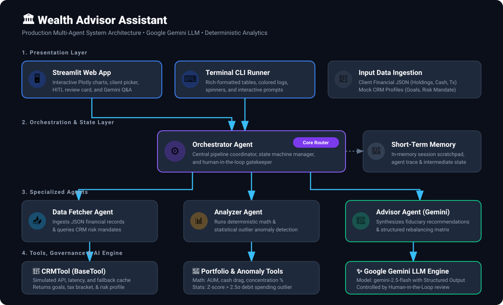
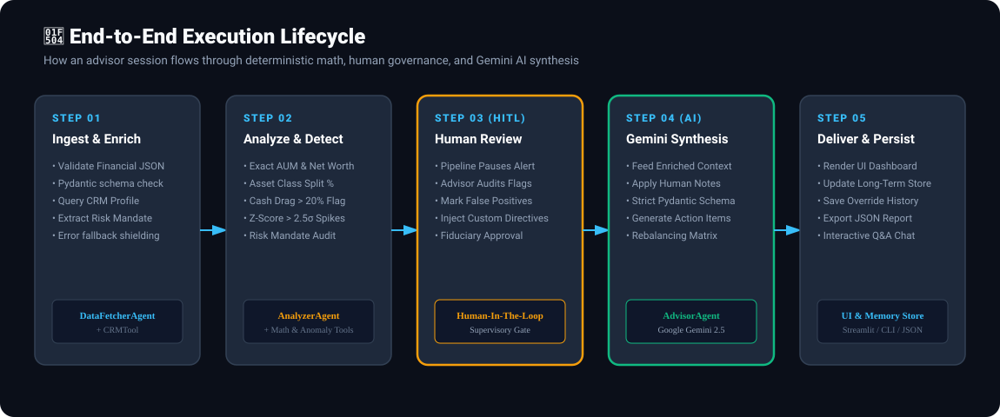

# 🏛️ Wealth Advisor Assistant — Multi-Agent System

[](https://www.python.org/downloads/)
[](https://ai.google.dev/)
[](https://streamlit.io/)
[](https://opensource.org/licenses/MIT)

An institutional-grade, autonomous **Multi-Agent Wealth Advisor Assistant** built with **Google Gemini LLM**, Python, and Streamlit. The system combines deterministic quantitative portfolio analytics, statistical anomaly detection ($Z\ge 2.5\sigma$), an interactive **Human-in-the-Loop (HITL)** governance checkpoint, and a persistent memory layer.

---

## 🏗️ 1. System Architecture

The architecture enforces a strict division of labor: **deterministic math and anomaly detection are executed via typed Python tools**, while **fiduciary synthesis, risk interpretation, and advisory formulation are handled by Google Gemini**.

<p align="center">
  
</p>

### 🧩 Core Component Matrix

| Component | Responsibility | Tech / Pattern |
| :--- | :--- | :--- |
| **Orchestrator Agent** | Coordinates workflow, state progression, and HITL gating | Deterministic State Graph / Dispatcher |
| **Data Fetcher Agent** | Ingests JSON, normalizes data, and queries CRM profile | Pydantic v2 + `CRMTool` with Fallback Cache |
| **Analyzer Agent** | Portfolio math, asset allocation %, and anomaly detection | `PortfolioMetricsTool` + `AnomalyDetectionTool` |
| **Advisor Agent** | Synthesizes personalized advisory strategy and rebalancing | **Google Gemini LLM** (`gemini-2.5-flash`) |
| **Tool Abstraction** | Decouples agent logic from raw external implementations | `BaseTool` Abstract Interface with Validation |
| **Memory Layer** | Session state tracking + cross-session historical continuity | Short-Term Scratchpad + Long-Term JSON Store |
| **Human-in-the-Loop** | Fiduciary review gate to override anomalies & steer advice | Interactive Checkpoint Form (Streamlit & CLI) |

---

## 🔄 2. End-to-End Execution Lifecycle

How an advisory session moves from raw account statements to finalized, client-ready advisory decisions:

<p align="center">
  
</p>

### ⏱️ The 5-Step Process Explained

```text
[Step 1: Ingestion & CRM] ➔ [Step 2: Math & Anomalies] ➔ [Step 3: Human Review Gate] ➔ [Step 4: Gemini LLM Synthesis] ➔ [Step 5: Report & Memory]
```

1. **Step 1 — Ingestion & Enrichment (`DataFetcherAgent`):**
   * Validates financial JSON schemas (holdings, balances, transactions).
   * Queries enterprise CRM via `CRMTool` for client goals, risk mandates, and tax brackets.
2. **Step 2 — Quantitative Analysis & Anomaly Detection (`AnalyzerAgent`):**
   * Computes exact Net Worth, AUM, Asset Class Split %, Cash Drag %, and Concentration Risks.
   * Runs statistical anomaly detection ($Z\text{-score} \ge 2.5\sigma$ on debit transactions, large outflow flags, and risk mandate mismatches).
3. **Step 3 — Human-in-the-Loop Governance (`HITLCheckpoint`):**
   * Halts the automated flow if high-risk anomalies are identified.
   * Allows the supervising advisor to approve findings, mark false positives, or type custom steering instructions.
4. **Step 4 — Gemini Strategic Synthesis (`AdvisorAgent`):**
   * Dispatches the enriched context and advisor directives to **Gemini LLM**.
   * Constrained via strict Pydantic schemas (`response_schema=AdvisoryReport`) to generate executive summaries, prioritized recommendations, and rebalancing matrices without hallucinations.
5. **Step 5 — Delivery & Historical Memory:**
   * Visualizes interactive charts and advisory tables in Streamlit.
   * Appends consultation outcomes to `historical_memory.json` for longitudinal context in future reviews.

---

## ⚖️ 3. Key Design Decisions & Trade-Offs

| Decision | Alternative Considered | Engineering Rationale |
| :--- | :--- | :--- |
| **Deterministic Python Math vs. LLM Math** | Asking LLM to calculate ratios and net worth | **Decision:** Python executes all arithmetic.<br>**Rationale:** LLMs hallucinate numbers. Wealth management demands 100% computational precision. |
| **Lightweight Native OOP vs. Heavy Frameworks** | LangGraph / CrewAI | **Decision:** Modular native OOP (`BaseAgent`, `BaseTool`, `OrchestratorAgent`).<br>**Rationale:** Zero third-party boilerplate; gives total transparency and full control over state transitions. |
| **Strict Pydantic Structured Outputs** | Free-form markdown with regex parsing | **Decision:** Enforce `response_schema=AdvisoryReport` with Gemini.<br>**Rationale:** Mathematical guarantee of schema conformance for downstream banking APIs. |
| **Two-Stage Decoupled Execution** | Monolithic single-shot run | **Decision:** Stage 1 (Analysis) $\rightarrow$ HITL Pause $\rightarrow$ Stage 2 (Synthesis).<br>**Rationale:** Fiduciary requirement; automated advice must never be dispatched without human compliance review. |

---

## 📁 4. Project Directory Structure

```text
wealth_advisor_assistant/
├── assets/                        # Architecture & lifecycle SVG diagrams
│   ├── architecture_diagram.svg
│   └── workflow_lifecycle.svg
├── app.py                         # Interactive Streamlit Web Dashboard
├── main.py                        # Standalone Rich Terminal CLI Runner
├── requirements.txt               # Pinned project dependencies
├── pytest.ini                     # Pytest environment configuration
├── .env.example                   # Gemini API key and environment template
├── data/
│   ├── sample_clients.json        # 3 diverse client scenarios (Retiree, Tech VP, Physician)
│   └── mock_crm_db.json           # CRM profiles, risk mandates, target allocations
├── memory_store/
│   └── historical_memory.json     # Persistent long-term memory store
├── src/
│   ├── config.py                  # Dynamic thresholds, model selection, paths
│   ├── models/                    # Pydantic data contracts
│   │   ├── client.py              # Holdings, transactions, CRM data models
│   │   ├── analysis.py            # Portfolio metrics & anomaly detection models
│   │   └── advisory.py            # Structured advisory report & rebalancing schemas
│   ├── tools/                     # Tool Abstraction Layer
│   │   ├── base.py                # Abstract BaseTool with schema validation & timing
│   │   ├── crm_tool.py            # CRM fetcher with simulated latency & fallback
│   │   ├── portfolio_tool.py      # Deterministic AUM, allocation %, cash drag calculator
│   │   └── anomaly_tool.py        # Statistical Z-score & risk profile anomaly detector
│   ├── memory/                    # Memory Subsystem
│   │   ├── short_term.py          # In-memory execution session scratchpad
│   │   └── long_term.py           # Persistent historical interaction & override store
│   ├── hitl/                      # Governance & Compliance
│   │   └── checkpoint.py          # Human-in-the-loop review and override processor
│   ├── agents/                    # Multi-Agent Layer
│   │   ├── base_agent.py          # BaseAgent with Gemini SDK & structured generation
│   │   ├── orchestrator.py        # Central workflow coordinator & state manager
│   │   ├── data_fetcher.py        # Data ingestion & schema normalization agent
│   │   ├── analyzer.py            # Financial analysis & anomaly detection agent
│   │   └── advisor.py             # Synthesis & actionable advice generation agent
│   └── utils/
│       └── logger.py              # Structured Rich logging & execution trace store
└── tests/
    ├── test_tools.py              # Unit tests for tools and fallback behaviors
    └── test_agents.py             # Integration test for end-to-end multi-agent pipeline
```

---

## 🚀 5. Quick Start Guide

### 1. Environment Setup
```bash
# Clone the repository
git clone https://github.com/tiwariaaryan/Wealth-Advisor-Assistant.git
cd Wealth-Advisor-Assistant

# Create and activate virtual environment
python3 -m venv .venv
source .venv/bin/activate

# Install dependencies
pip install -r requirements.txt
```

### 2. Configure API Key
```bash
cp .env.example .env
```
Add your **Google Gemini API Key** inside `.env`:
```ini
GEMINI_API_KEY=your_actual_gemini_api_key_here
GEMINI_MODEL=gemini-2.5-flash
```
*(Note: If no API key is provided, the system runs with its built-in deterministic fallback generator without crashing).*

### 3. Launch Streamlit Web UI
```bash
streamlit run app.py
```
Open **`http://localhost:8501`** to interact with the dashboard:
1. Select a client persona or upload a custom financial JSON.
2. Inspect portfolio metrics and allocation comparison charts.
3. Review flagged anomalies and override false positives via the **Human-in-the-Loop review form**.
4. Generate the full **Gemini Advisory Report** and export as JSON or Markdown.
5. Use the **Interactive Q&A Widget** to ask Gemini questions directly about the portfolio.

### 4. Run via Terminal CLI
```bash
# Interactive mode (prompts for Human-in-the-Loop input):
python main.py --client client_001

# Auto-approval mode:
python main.py --client client_002 --auto
```

### 5. Run Test Suite
```bash
pytest tests/ -v
```

---

## 👥 6. Built-in Client Personas

* **Arthur Pendleton (`client_001` - Conservative Retiree):**
  * *Profile:* 68 years old, pension recipient, capital preservation mandate.
  * *Anomalies:* $50,000 wire to offshore crypto custody, 33.5% cash drag ($395k in zero-yield cash).
* **Elena Rostova (`client_002` - Aggressive Tech VP):**
  * *Profile:* 34 years old, $360k income, aggressive growth mandate.
  * *Anomalies:* 65.8% portfolio concentration in NVIDIA (`NVDA`), high-interest margin loan ($75k at 8.5%).
* **Dr. Marcus Chen (`client_003` - Balanced Physician):**
  * *Profile:* 45 years old, balanced wealth accumulation & college fund goal.
  * *Anomalies:* Sudden $22,500 options trading outflow ($Z\text{-score} \ge 3.1\sigma$).
