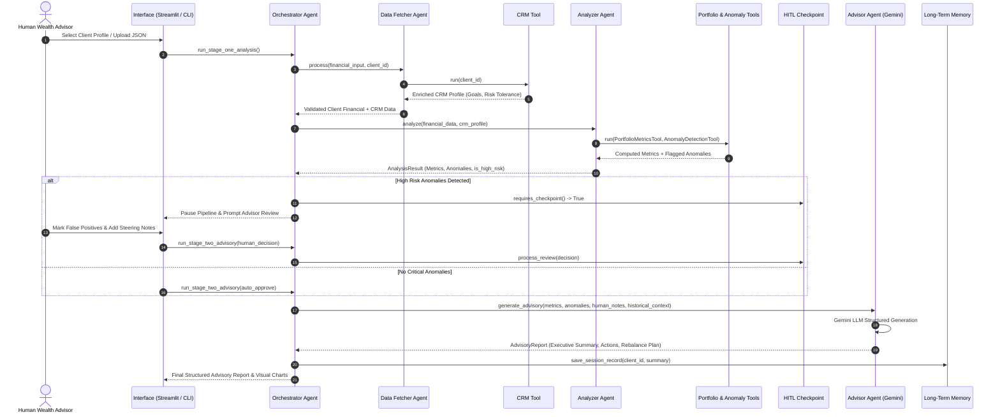

# 🏛️ Wealth Advisor Assistant — Multi-Agent System

An autonomous, production-grade **Multi-Agent System** simulating an institutional **Wealth Advisor Assistant**. Built with **Google Gemini LLM**, Python, and Streamlit, featuring deterministic quantitative analytics, statistical anomaly detection, a persistent memory layer, and an interactive **Human-in-the-Loop (HITL)** checkpoint.

---

## 📑 Table of Contents
1. [Architecture Design](#1-architecture-design)
2. [Agent Interactions & Flow](#2-agent-interactions--flow)
3. [Key Decisions & Trade-Offs](#3-key-decisions--trade-offs)
4. [Assumptions Made](#4-assumptions-made)
5. [Project Structure](#5-project-structure)
6. [Setup & Execution Instructions](#6-setup--execution-instructions)
7. [Sample Scenarios & Outputs](#7-sample-scenarios--outputs)

---

## 1. Architecture Design

The system decouples **probabilistic reasoning** (LLM-based advisory synthesis and contextual explanation) from **deterministic computation** (portfolio arithmetic, statistical Z-score outlier detection, allocation percentages).

```mermaid
flowchart TD
    subgraph UI_Layer ["Interface Layer"]
        CLI[Rich Terminal CLI: main.py]
        Web[Streamlit Web App: app.py]
    end

    subgraph Orchestration_Layer ["Central Orchestration"]
        Orch[Orchestrator Agent]
        STM[(Short-Term Memory / Session Scratchpad)]
    end

    subgraph Agents_Layer ["Specialized Agents"]
        DFA[Data Fetcher Agent]
        ANA[Analyzer Agent]
        ADA[Advisor Agent (Gemini LLM)]
    end

    subgraph Tools_Layer ["Tool Abstraction Layer (BaseTool)"]
        CRM_T[CRM Tool]
        Port_T[Portfolio Metrics Tool]
        Anom_T[Anomaly Detection Tool]
    end

    subgraph Governance ["Human Governance & Memory"]
        HITL{Human-in-the-Loop Checkpoint}
        LTM[(Long-Term Memory Store: JSON/SQLite)]
    end

    CLI & Web --> Orch
    Orch <--> STM
    Orch --> DFA
    DFA --> CRM_T
    DFA --> STM
    Orch --> ANA
    ANA --> Port_T
    ANA --> Anom_T
    ANA --> STM
    Orch --> HITL
    HITL -->|Advisor Approvals / Overrides / Directives| Orch
    Orch --> ADA
    ADA --> Orch
    Orch --> LTM
    Orch --> CLI & Web
```

### Core Architecture Components

1. **Orchestrator Agent:** The central deterministic coordinator. Manages task sequencing, state progression, exception handling, and gating conditions (e.g., pausing execution when critical anomalies are flagged).
2. **Specialized Agents:**
   * **Data Fetcher Agent:** Validates client financial payloads (Pydantic), communicates with the CRM via tool abstraction, and normalizes disparate records.
   * **Analyzer Agent:** Executes deterministic financial calculations (AUM, Net Worth, Cash Drag, Concentration Risk) and detects multi-faceted anomalies (statistical Z-score spikes, large outflows, risk profile mismatch).
   * **Advisor Agent:** Powered by **Google Gemini** with Pydantic structured output enforcement (`response_schema=AdvisoryReport`). Translates metrics and human steering into fiduciary recommendations.
3. **Tool Usage Abstraction (`BaseTool`):** Abstract class with strict input validation (`args_schema`), automated error isolation, and execution latency measurement. Agents never interact with raw database connections or HTTP endpoints.
4. **Memory Layer:**
   * **Short-Term Memory:** In-memory session scratchpad tracking execution traces, intermediate tool outputs, and state transitions.
   * **Long-Term Memory:** Persistent store capturing consultation histories, recurring anomaly patterns, and past advisor overrides for cross-session continuity.
5. **Human-in-the-Loop (HITL) Checkpoint:** Fiduciary safety gate. When anomalies are categorized as `HIGH` or `CRITICAL`, the pipeline halts, allowing a human wealth advisor to approve, override false positives, or inject steering directives before final advice is synthesized.

---

## 2. Agent Interactions & Flow



---

## 3. Key Decisions & Trade-Offs

| Decision | Alternative Considered | Rationale & Trade-Off |
| :--- | :--- | :--- |
| **Deterministic Math in Python vs. LLM Arithmetic** | Asking LLM to calculate ratios and net worth | **Decision:** Python executes all arithmetic (`PortfolioMetricsTool`, `AnomalyDetectionTool`).<br>**Rationale:** LLMs hallucinate math. Wealth management requires 100% calculation accuracy. |
| **Lightweight Native Multi-Agent Architecture** | LangGraph / CrewAI | **Decision:** Custom modular OOP architecture (`BaseAgent`, `BaseTool`, `OrchestratorAgent`).<br>**Rationale:** Removes heavyweight third-party abstraction overhead, giving full transparency into state and deterministic control during interviews/evaluations. |
| **Strict Pydantic Structured Outputs** | Free-form markdown with regex parsing | **Decision:** Enforce `response_schema=AdvisoryReport` with Gemini.<br>**Rationale:** Guarantees zero schema drift and ensures outputs can be directly digested by downstream banking APIs. |
| **Dual Interface (Streamlit + Rich CLI)** | Web UI only or CLI only | **Decision:** Provide both `app.py` and `main.py`.<br>**Rationale:** Evaluators can run headless CLI tests with zero browser setup or explore the interactive graphical dashboard with Plotly charts and HITL forms. |
| **Two-Stage Decoupled Execution** | Single-shot monolithic pipeline run | **Decision:** Stage 1 (Analysis) $\rightarrow$ HITL Pause $\rightarrow$ Stage 2 (Synthesis).<br>**Rationale:** Critical for production wealth systems where automated recommendations cannot be dispatched without human compliance sign-off. |

---

## 4. Assumptions Made

1. **Data Format:** Input client financial data is provided in JSON format containing liquid cash balance, holdings list (symbol, asset class, quantity, price, value), liabilities, and recent transaction records.
2. **CRM Integration:** Simulated as a fast, reliable internal microservice. If the CRM service times out or the client ID is missing, the system gracefully falls back to a standard conservative profile and logs a warning rather than crashing.
3. **Threshold Values:**
   * **Cash Drag:** Flagged when uninvested cash exceeds **20%** of total AUM.
   * **Concentration Risk:** Flagged when a single holding represents $\ge$ **30%** of total AUM.
   * **Spending Spike:** Flagged when a transaction exceeds the statistical mean by $\ge$ **2.5 standard deviations** ($\sigma$).
   * **Large Outflow:** Flagged for any single debit $\ge$ **$25,000**.
4. **Fiduciary Compliance:** Generated advisory notes include institutional disclaimers stating that all strategies represent simulations and require human advisor validation.

---

## 5. Project Structure

```text
wealth_advisor_assistant/
├── app.py                         # Streamlit interactive Web Application
├── main.py                        # Standalone CLI entrypoint with Rich terminal UI
├── requirements.txt               # Project dependencies
├── pytest.ini                     # Pytest configuration
├── .env.example                   # Gemini API key and environment template
├── data/
│   ├── sample_clients.json        # 3 diverse client scenarios (Retiree, Tech VP, Physician)
│   └── mock_crm_db.json           # CRM profiles, goals, risk mandates, and advisor notes
├── memory_store/
│   └── historical_memory.json     # Persistent long-term memory store
├── src/
│   ├── config.py                  # Thresholds, model settings, and paths
│   ├── models/                    # Pydantic schemas
│   │   ├── client.py              # Holdings, liabilities, transactions, CRM data
│   │   ├── analysis.py            # Portfolio metrics, allocations, anomaly models
│   │   └── advisory.py            # Structured advisory report & rebalancing models
│   ├── tools/                     # Tool Abstraction Layer
│   │   ├── base.py                # Abstract BaseTool with schema validation & latency timing
│   │   ├── crm_tool.py            # CRM fetcher with simulated latency & fallback
│   │   ├── portfolio_tool.py      # Deterministic AUM, allocation %, cash drag calculator
│   │   └── anomaly_tool.py        # Statistical Z-score & risk profile anomaly detector
│   ├── memory/                    # Memory Subsystem
│   │   ├── short_term.py          # In-memory execution session scratchpad
│   │   └── long_term.py           # Persistent historical interaction & override store
│   ├── hitl/                      # Governance & Compliance
│   │   └── checkpoint.py          # Human-in-the-loop review and override processor
│   ├── agents/                    # Multi-Agent Layer
│   │   ├── base_agent.py          # BaseAgent with Gemini SDK & structured generation
│   │   ├── orchestrator.py        # Central workflow coordinator & state manager
│   │   ├── data_fetcher.py        # Data ingestion & schema normalization agent
│   │   ├── analyzer.py            # Financial analysis & anomaly detection agent
│   │   └── advisor.py             # Synthesis & actionable advice generation agent
│   └── utils/
│       └── logger.py              # Structured Rich logging & execution trace store
└── tests/
    ├── test_tools.py              # Unit tests for tools and fallback behaviors
    └── test_agents.py             # Integration test for end-to-end multi-agent pipeline
```

---

## 6. Setup & Execution Instructions

### Prerequisites
* Python 3.10+ (Tested on Python 3.13)
* Google Gemini API Key ([Google AI Studio](https://aistudio.google.com/))

### 1. Activate Environment & Install Dependencies
```bash
cd wealth_advisor_assistant
source .venv/bin/activate
pip install -r requirements.txt
```

### 2. Configure Environment Variables
Copy `.env.example` to `.env` and insert your Gemini API Key:
```bash
cp .env.example .env
```
Edit `.env`:
```ini
GEMINI_API_KEY=your_actual_gemini_api_key_here
GEMINI_MODEL=gemini-2.5-flash
LOG_LEVEL=INFO
```
*(Note: If no API key is provided, the system automatically runs using its built-in deterministic fallback generator without crashing!)*

### 3. Run the Streamlit Web Application
```bash
streamlit run app.py
```
Open your browser to `http://localhost:8501`. You can:
1. Select from 3 pre-loaded client scenarios or upload a custom financial JSON.
2. Inspect the live portfolio snapshot and allocation comparison charts.
3. Review detected anomalies and use the **Human-in-the-Loop form** to override false positives or inject custom steering notes.
4. Generate and download the full structured report as **JSON** or **Markdown**.

### 4. Run via Terminal CLI
```bash
# Run with interactive Human-in-the-Loop prompt:
python main.py --client client_001

# Run with auto-approval (for automated scripts):
python main.py --client client_002 --auto

# Run with custom JSON file:
python main.py --file data/sample_clients.json --auto
```

### 5. Run the Test Suite
```bash
pytest tests/ -v
```

---

## 7. Sample Scenarios & Outputs

### Preset 1: Arthur Pendleton (Conservative Retiree)
* **Profile:** 68 years old, living off fixed income and state pension. Risk Mandate: Conservative.
* **Anomalies Detected:**
  * `[CRITICAL] UNUSUAL_OUTFLOW`: $50,000 wire to offshore crypto custody (`MoonPay/Binance`).
  * `[MEDIUM] CASH_DRAG`: 33.5% of portfolio ($395,000) sitting in zero-yield checking cash.
  * `[CRITICAL] RISK_PROFILE_MISMATCH`: Holds speculative crypto assets despite zero-risk tolerance mandate.
* **Human-in-the-Loop Action:** Advisor marks the $50,000 wire as an authorized family gift, and commands Gemini to rebalance cash into high-yield treasury bonds.

### Preset 2: Elena Rostova (Aggressive Tech Executive)
* **Profile:** 34 years old, high earned income ($360k/yr). Risk Mandate: Aggressive Growth.
* **Anomalies Detected:**
  * `[HIGH] CONCENTRATION_RISK`: Single stock holding (NVIDIA) accounts for 65.8% of portfolio AUM.
  * `[HIGH] HIGH_LEVERAGE`: Margin debt of $75,000 at 8.5% interest rate.
* **Advisory Output:** Recommends zero-cost collar hedging and systematic 10b5-1 divestment into broad-market index ETFs (`VTI`, `QQQ`) to reduce single-company volatility while optimizing tax liability.
